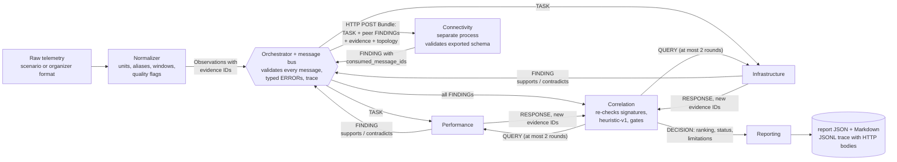

# NetCoop AI

Five specialist agents exchange validated evidence over a versioned protocol, verify each other's conclusions, and publish one explainable diagnosis of a campus network fault, or say plainly that the evidence is not enough.

Built for the [NetCoop AI problem statement](docs/problem_statement.pdf). Agents are deterministic and rule-based. All telemetry is synthetic, and nothing touches a real network.

## Problem

A campus network fault rarely shows up in one place. Utilization lives on the switch, latency in a client probe, and DNS health in a service check. Those sources use different names, units and clocks, and some are missing or stale.

Several causes can produce the same symptom: a saturated uplink and a failing interface both produce loss. A confident wrong answer costs more than no answer, because an engineer then replaces a cable that was never faulty.

## Solution

Each agent owns one part of the evidence and publishes findings as protocol messages that others can use or contest. Correlation sees all the evidence when it decides, but it can only rank causes the agents raised, and it must show the checks behind its answer.

- **Performance** and **Infrastructure** analyse their own signals, and may argue against a cause as well as for it.
- **Connectivity** runs as a separate HTTP process. It receives their findings and works out what they mean for the topology.
- **Correlation** re-checks every nominated cause against the raw evidence, queries the agent that owns a disputed measurement, and applies explicit gates. Agreement between agents earns nothing.
- **Reporting** publishes the result, citing only evidence that exists.

## Key capabilities

| Capability | Where to verify it |
|---|---|
| Versioned protocol `netcoop/1.0` with generated JSON Schemas, 1.x tolerance, a 0.9 upgrade path and 2.x rejection | [PROTOCOL.md](PROTOCOL.md), [schemas/](schemas/), `netcoop run scenarios/dev/schema_0_9.json` |
| An agent in its own process, validating against the exported schema | [docs/CONNECTIVITY_SERVICE.md](docs/CONNECTIVITY_SERVICE.md), [examples/wire/](examples/wire/) |
| Evidence-based comparison of competing causes, each with supporting and contradicting findings | Dashboard, "Competing causes" |
| Bounded verification: at most two QUERY rounds per attempt, on-demand probes when available | `scenarios/dev/ambiguous_congestion_errors.json` |
| Contradiction and uncertainty handling: `probable` names its open rival, `insufficient_evidence` names no cause | `limitations` in every report |
| Typed errors at the bus and HTTP boundaries, with incident and sender checks; a failed component degrades the report | [ARCHITECTURE.md §6](ARCHITECTURE.md#6-failure-handling), `tests/test_adversarial.py`, `tests/test_failure_recovery.py` |
| Reproducible evaluation on a held-out generator, with every run and non-exact case archived | [docs/results/EVALUATION.md](docs/results/EVALUATION.md) |

## Architecture



Details and decision gates: [ARCHITECTURE.md](ARCHITECTURE.md).

## Quick start

Requires **Python 3.12** and, for the dashboard, **Node.js 22 or newer**. Run everything from the repository root.

```bash
python -m venv .venv
```

On Windows, if `python` is not found, use `py -3.12 -m venv .venv`. Activate it with `.venv\Scripts\activate` on Windows or `source .venv/bin/activate` on macOS and Linux, then:

```bash
pip install -r requirements.lock.txt -e ".[dev]"
```

```bash
pytest -q
```

```bash
netcoop demo
```

`netcoop demo` runs all 17 labelled scenarios and prints expected against actual. It ends with `17/17 scenarios match their label` and writes `reports/` and `traces/`. It runs Connectivity in-process, so no server is needed.

## Live demonstration

In one terminal, start Connectivity as its own process:

```bash
uvicorn connectivity_service.app:app --port 8001
```

In a second terminal, run a fault and its control:

```bash
netcoop run scenarios/dev/congestion.json
```

```bash
netcoop run scenarios/dev/congestion.json --control
```

Then a case with two competing causes:

```bash
netcoop run scenarios/dev/ambiguous_congestion_errors.json
```

Open the dashboard from a third terminal:

```bash
npm --prefix dashboard ci
```

```bash
npm --prefix dashboard run dev
```

Go to http://localhost:5173 and select an incident. The dashboard reads the real `reports/` and `traces/`, validates each message in the browser against `schemas/`, and shows the diagnosis, competing causes, verification rounds, the message timeline and the control comparison. Reload after new runs.

Without the dashboard, `reports/INC-0103.md` is the readable report and `traces/INC-0103.jsonl` is the full trace. If the server is not running, `netcoop run` warns you and the report degrades to `probable` at most. `netcoop run` exits 0 when a report was produced, 1 for a `failed` run and 2 for `invalid_input`. `--local` runs Connectivity in-process instead.

The untouched organizer output is accepted as is:

```bash
netcoop run data/generator_raw/hardware_failure_unseeded.json
```

The generator emits one reading for one device, so the agents abstain and say why.

## Example diagnosis

Output of `scenarios/dev/congestion.json` (`INC-0103`, "Hostel blocks report slow internet in the evening") over real HTTP. The recorded run is in [docs/demo/recorded/](docs/demo/recorded/).

**1. Two agents find evidence independently.**

| Message | Finding |
|---|---|
| `INC-0103-PERF-03` (`F-PERF-03`) | `link_congestion@HOSTEL_UPLINK_01` supports: utilization above 90% for 3 consecutive samples, latency p95 274.3 ms, queue-drop counter rose |
| `INC-0103-INF-02` (`F-INF-02`) | `link_congestion@HOSTEL_UPLINK_01` supports: queue drops on `SW_CAMPUS_1` rose by 2150 while utilization is high |

**2. Connectivity consumes those findings over HTTP.** The orchestrator POSTs a Bundle holding the TASK and five peer FINDINGs, and gets HTTP 200.

`F-CONN-03` lists `consumed_message_ids: [INC-0103-INF-02, INC-0103-PERF-03]`. From its own reachability checks it concludes a blast radius of 6 devices, all checked devices answering: "a degradation, not an outage". It cites only its own evidence, so one measurement cannot count as two sources.

**3. Correlation verifies.** `Q-01` asks Performance for `link_utilization_pct` on the uplink, and the on-demand probe returns three new samples: 95.8, 96.9, 94.7. The score moves from 0.96 to 1.00.

**4. The report cites actual evidence.** Status `diagnosed`, reported confidence 0.95 (the 1.00 score is capped, and the report says so).

| Evidence | Metric | Value | Interpretation | Source |
|---|---|---|---|---|
| `EV-047` | `link_utilization_pct` | 93.4 % | above critical 90 percent | switch-telemetry |
| `EV-079` | `queue_drops` | 2620 | +610 in one interval, at or above critical 100 | switch-telemetry |
| `EV-120` | `latency_ms` | 220.2 ms | above critical 200 ms | client-probe |

Fault location: `HOSTEL_UPLINK_01`, `SW_CAMPUS_1`. Impact scope: the 6 devices behind it. Limitation stated in the report: one 5-minute window, and a heuristic score that is not a probability.

**What the exchange changes.** With `--control`, Connectivity receives no peer findings and `F-CONN-03` does not exist. `topology_fit` falls from 1.0 to 0.5.

| | With peer findings | Control |
|---|---|---|
| Peer findings sent to Connectivity | 5 | 0 |
| Findings built on a peer's message | 1 (`F-CONN-03`) | 0 |
| `heuristic-v1` score | 1.00 | 0.88 |
| Status | `diagnosed` | `diagnosed` |

Of the 16 labelled scenarios that parse, the control changes the leading score in 6 and the status in none. On the held-out set the control changes no outcome at σ 0 or σ 0.10. The exchange adds scope and raises scores; we have not shown that it improves accuracy, and we did not benchmark a centralized design.

**When evidence conflicts.** In `ambiguous_congestion_errors` (`INC-0108`), congestion and an interface fault both pass their signatures on one uplink. Interface fault leads 0.92 to 0.90.

Q-01 finds the error rate reaches only the warn level, and Q-02 confirms critical utilization, so the ranking **flips** to congestion 0.94 against interface fault 0.91. The 0.03 lead is below the 0.15 gate, so the report says `probable`, names the rival, and recommends ruling it out before acting.

## Evaluation

| Layer | What it is | Result |
|---|---|---|
| Unit and integration tests | `pytest -q`, including the Connectivity service over its HTTP interface | 541 pass, including `tests/test_adversarial.py` (replayed polls, contradicting probes, forged messages, omitted sensors, hung steps) |
| Regression scenarios | 17 labelled fixtures in `scenarios/dev/`, available during development | 17/17 |
| Held-out evaluation | `netcoop eval`: generated cases, 8 classes, 30 per class | Below |

Seeds 6 to 10, 240 cases per noise level, on the current code. Noise is multiplicative Gaussian on gauges.

| | σ 0 | σ 0.05 | σ 0.10 | σ 0.15 |
|---|---|---|---|---|
| Exact (status and cause) | 100 % | 100 % | 99.2 % | 96.3 % |
| False diagnosis on no-fault classes (90 cases) | 0 | 0 | 0 | 0 |
| Wrong cause, stated or hedged | 0 | 0 | 0 | 0 |
| Abstained on a fault class | 0 | 0 | 2 | 6 |
| Right cause, weaker status | 0 | 0 | 0 | 3 |
| Fault-location accuracy, evidence-link integrity | 100 % | 100 % | 100 % | 100 % |

Reproduce one column with:

```bash
netcoop eval --n 48 --seed 6 7 8 9 10 --noise 0.10
```

Seeds 11 to 15, first used after the last logic change, give 100 %, 100 %, 97.9 % and 96.3 %, again with no wrong cause and no false diagnosis.

**These numbers come from our own fault model.** Expected answers share the system's design assumptions, so they show that the logic holds across positions, timing and noise. They do not independently validate the model or predict results on real campus telemetry. There are no held-out two-fault incidents, and `hardware_failure` and `device_overload` are covered by tests only.

The first held-out run found a real bug (poller jitter read as a missing sample). That run, the fix, and every non-exact case's trace are in [docs/results/EVALUATION.md](docs/results/EVALUATION.md).

## Technology stack

Python 3.12 · Pydantic · FastAPI and Uvicorn · HTTPX · jsonschema · PyYAML · SQLite event log · pytest · React, Vite and TypeScript · Ajv · GitHub Actions

## Repository layout

| Path | Contents |
|---|---|
| `netcoop/cli.py` | Entry point: `netcoop run`, `demo`, `eval`, `export-schemas` |
| `netcoop/agents/` | Performance, Infrastructure, Correlation and Reporting |
| `connectivity_service/` | Connectivity agent, as a FastAPI process |
| `netcoop/protocol/` | Protocol models (source of truth), version compatibility, agent cards |
| `netcoop/orchestrator/` | Pipeline, message bus, event log, HTTP client |
| `netcoop/normalizer/` | Telemetry normalization and the organizer-format adapter |
| `netcoop/config/signatures-1.0.yaml` | Thresholds, fault signatures, decision gates |
| `netcoop/evaluation/` | Held-out generator and scoring |
| `dashboard/` | React dashboard over real runs |
| `scenarios/` | Topology, labelled fixtures, labels (read only for scoring) |
| `data/generator_raw/` | Untouched organizer output and field mapping |
| `examples/` | One valid message of each type, version samples, wire bodies |
| `schemas/` | Generated JSON Schemas |
| `tests/` | Test suite |
| `reports/`, `traces/` | Generated run output (not committed) |
| `docs/` | [Demo script](docs/DEMO_SCRIPT.md), [evaluation](docs/results/EVALUATION.md), [recorded runs](docs/demo/recorded/), [engineering history](docs/history/) |

## Limitations and future work

- **No validation on real telemetry.** Accuracy is measured only on our generator, and thresholds are heuristics from public guidance and judgement.
- **Confidence is not a probability.** It has not been calibrated against outcomes.
- **The organizer generator gives one reading per call**, with no topology or labels. We show that the format is ingested, not that the system diagnoses from it.
- **One telemetry window.** Each run is a batch over five minutes; there is no streaming or incident memory.
- **One remote service, not five.** Connectivity is process-separated, but it shares a codebase, and the other four agents run in-process over shared incident data.
- **Sender identity is checked, not authenticated.** A registered name can still be forged, and a replay with fabricated new timestamps cannot be detected from the data alone.
- **Fixed topology:** a tree from `scenarios/topology.json`; multi-homed paths are not modelled.

Next steps would be replaying real SNMP and probe captures, calibrating confidence, benchmarking a centralized design, and moving more agents behind the same HTTP contract. None of these is implemented.

## Team and contributions

Roles below come from the commit history and [task records](docs/history/).

| Member | Git author | Contribution |
|---|---|---|
| Sayan Majhi | Sayan Majhi | Protocol, agent base and pipeline, Correlation, Reporting, labelled fixtures, held-out evaluation, dashboard |
| Gaurav | Gaurav_C19 | Organizer data capture and field mapping, signature thresholds, normalizer, Performance agent |
| Amit | amit-cmd123 | Topology, message bus, event log, Connectivity REST service and logic, Infrastructure agent |

AI assistants were used during development, for coding and as an independent phase reviewer. The review verdicts are recorded in [docs/history/STATUS.md](docs/history/STATUS.md).
