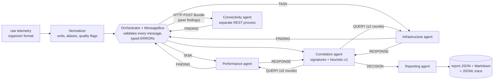

# NetCoop AI

Five specialist agents exchange **validatable evidence** over a versioned protocol (`netcoop/1.0`), challenge one another, and publish **one** evidence-based JSON diagnosis of a campus network fault. Data is synthetic; nothing touches a real network.

- Problem statement: [docs/problem_statement.pdf](docs/problem_statement.pdf)
- Architecture: [ARCHITECTURE.md](ARCHITECTURE.md) · context for AI coding assistants: [CLAUDE.md](CLAUDE.md)
- Phase plan and status: [docs/STATUS.md](docs/STATUS.md) · Phase 1 tasks: [docs/PHASE1_TASKS.md](docs/PHASE1_TASKS.md)
- Protocol and field reference: [PROTOCOL.md](PROTOCOL.md), generated JSON Schemas in [schemas/](schemas/)
- Organizer data and field mapping: [data/field_mapping.md](data/field_mapping.md)
- Connectivity REST service: [docs/README_track_C.md](docs/README_track_C.md)
- Demo plan: [docs/DEMO_SCRIPT.md](docs/DEMO_SCRIPT.md)

## Setup (Python 3.12)
```bash
python -m venv .venv
.venv\Scripts\activate          # macOS/Linux: source .venv/bin/activate
pip install -e ".[dev]"
pytest -q                       # 480+ tests
```

## Judge quickstart (one command)
```bash
netcoop demo        # runs all 17 labelled scenarios, prints expected vs got, writes reports/ + traces/
```
```
scenario                     expected                   got                        conf  rejected inputs
congestion                   diagnosed link_congestion  diagnosed link_congestion  0.95  -                           PASS
ambiguous_congestion_errors  probable link_congestion   probable link_congestion   0.69  -                           PASS
unsupported_2_x              insufficient_evidence      insufficient_evidence      0.00  SCHEMA_VERSION_UNSUPPORTED  PASS
...
17/17 scenarios match their label
```
Then open the dashboard on those real runs (report, one-line summary, every message of the trace incl. QUERY/RESPONSE, competing causes, interpreted evidence):
```bash
cd dashboard && npm install && npm run dev
```



## Run
```bash
# terminal 1 - the Connectivity agent as its own process
uvicorn connectivity_service.app:app --port 8001

# terminal 2 - diagnose a scenario (report -> reports/, trace with HTTP bodies -> traces/)
netcoop run scenarios/dev/congestion.json
netcoop run scenarios/dev/congestion.json --control   # Connectivity gets no peer findings: its answer changes
netcoop run scenarios/dev/congestion.json --local     # Connectivity in-process (no server needed)
netcoop run data/generator_raw/hardware_failure_unseeded.json   # untouched organizer output (1 reading: agents abstain and say why)

netcoop export-schemas                    # regenerate schemas/ + PROTOCOL.md after editing models.py
python scenarios/build_dev_fixtures.py    # rebuild the 17 labelled scenarios in scenarios/dev/
netcoop eval --n 48 --seed 6 7 8 9 10 --noise 0.10   # held-out evaluation -> eval/<run>/summary.md
```
Each run writes `reports/<incident>.json` (the report-1.0 diagnosis), `reports/<incident>.md` (the same report for humans) and `traces/<incident>.jsonl` (every message, including the QUERY/RESPONSE rounds and the HTTP bodies to and from Connectivity). Statuses: `diagnosed`, `probable`, `healthy`, `insufficient_evidence`, `invalid_input`, `failed`.

### How verification works (QUERY)
Before deciding, Correlation **verifies** the leading hypothesis (and a close rival) by sending a QUERY to the agent that owns its key measurement (e.g. utilization → Performance, interface errors → Infrastructure).
- If the scenario has **on-demand probe samples** (`on_query` block, source `on-demand-probe`), the agent *runs the probe*: the RESPONSE cites **new evidence IDs** that did not exist before the QUERY, and Correlation grades severity (critical vs only warn) from them. Those samples grade severity only; the signature checks stay on the 5-minute window.
- If there is no probe data, the agent **re-reads the window's samples** and says so in the RESPONSE ("no new probe was run"); the DECISION repeats it. Nothing new is claimed.
- DNS/DHCP faults are not queried: their evidence is Connectivity's own pass/fail service checks, already in hand.
- Confidence on `correlation_timeout` is `0.0` with method `none: correlation_failed (no heuristic-v1 score could be computed)`: no ranking was possible, and the report says so.

### How a diagnosis is decided
Agents nominate hypotheses; the **Correlation agent** re-checks each one against its signature in `netcoop/config/signatures-1.0.yaml`, verifies the leader (and a close rival) with a **QUERY** to the agent that owns the key measurement, and scores it with **`heuristic-v1`** (`netcoop/agents/correlation.py` documents every factor). Gates: `diagnosed` needs confidence ≥ 0.70, coverage ≥ 0.75, two independent raw sources, a 0.15 lead **and no unresolved rival** (a hypothesis the agents raised that the evidence can neither confirm nor refute is listed in `alternative_causes` and blocks a diagnosis); `probable` names what is missing; `healthy` needs normal measurements **and** passing service and path checks; otherwise the system abstains with `insufficient_evidence`. Confidence values are documented heuristics, not calibrated probabilities, so the report caps them by status: `diagnosed`/`healthy` at most 0.95 (nothing from one window is certain) and `probable` at most 0.69 (it never outscores a cause that passed the 0.70 gate). The uncapped score stays in the DECISION and the cap is named in `limitations`.

### What every report tells you
- `summary`: one plain sentence, e.g. *Probably link congestion on DEPT_UPLINK_01, affecting SW_CAMPUS_2, but not confirmed: interface_fault@DEPT_UPLINK_01 cannot yet be ruled out. Verify before acting.*
- `supporting_evidence[]`: evidence ID, metric, value, unit, raw source, per-interval delta for counters, and `interpretation` against the configured threshold (*above critical 90 percent*).
- `validation_errors`: every input message the bus rejected, with its typed code and field (`SCHEMA_VERSION_UNSUPPORTED`, `MISSING_FIELD`, `DUPLICATE_MESSAGE`, ...).
- `limitations`: the time window, the confidence cap, any malformed/missing/stale readings that were excluded, and the before/after ranking of each QUERY round.

### Held-out evaluation (Phase 4)
`netcoop eval` generates incidents from `netcoop/evaluation/heldout.py` (committed before any result was looked at; new seeds, times, topology positions and metric mixes; labels come from the fault the generator overlays, never from the system), runs each one, and publishes every ARCHITECTURE §7 metric. Results, with the pre-registered first run, the bug it found and every non-exact case's trace: [`docs/results/PHASE4_RESULTS.md`](docs/results/PHASE4_RESULTS.md).

| fresh seeds 6–10, 240 cases | σ 0 | σ 0.05 | σ 0.10 | σ 0.15 |
|---|---|---|---|---|
| exact (status + cause) | 100 % | 100 % | 99.2 % | 96.7 % |
| false diagnosis on healthy / busy-but-healthy / stale (90 cases) | 0 | 0 | 0 | 0 |
| wrong diagnoses / hedged wrong | 0 / 0 | 0 / 0 | 0 / 0 | 0 / 0 |
| abstained (fault classes) | 0 | 0 | 2 | 6 |

These numbers come from our own fault model: they show the logic holds across positions, timing and noise, not how it would score on real campus telemetry.

## How it works
| Component | Role |
|---|---|
| Normalizer | Converts raw telemetry to canonical observations; keeps original field/value; flags missing, stale, converted data (never turns missing into 0) |
| Orchestrator + bus | Validates **every** message, drops duplicates, turns every failure into a typed `ERROR`, logs all traffic to SQLite |
| Performance agent | Latency, jitter, loss, throughput, utilization |
| Infrastructure agent | CPU/memory, queue drops, interface errors, flaps, Wi-Fi signal/retries; emits supporting **and contradicting** findings |
| Connectivity agent | Separate REST process; topology, blast radius, DNS/DHCP, reachability; reads peer findings before answering |
| Correlation agent | Ranks causes, sends QUERY when evidence conflicts, abstains when evidence is thin (`heuristic-v1` confidence) |
| Reporting agent | Produces the final JSON report using only cited evidence |

Statuses: `diagnosed`, `probable`, `healthy`, `insufficient_evidence`, `invalid_input`, `failed`. Only the first two may name a cause.

## Repository layout
| Path | Contents |
|---|---|
| `netcoop/protocol/` | Protocol models (source of truth), schema export, version compatibility, agent cards |
| `netcoop/normalizer/` | Organizer-generator adapter |
| `netcoop/orchestrator/` | Message bus and SQLite event log |
| `netcoop/config/signatures-1.0.yaml` | Versioned thresholds, fault signatures, check vocabulary, decision gates |
| `connectivity_service/` | Connectivity agent REST service |
| `scenarios/` | Topology, labeled dev scenarios (`labels.json` is never read at runtime) |
| `examples/` | One valid message per type, old/new-version samples, report samples |

## Team workflow
- One branch per task (`m1/<name>-<topic>`), PR + one review, `pytest -q` green on `main`.
- Only the protocol lead edits `netcoop/protocol/models.py`; run `netcoop export-schemas` and commit the regenerated files in the same PR.

## Limitations
- The organizer generator returns one reading for one device per call, with no topology, repeated samples or fault labels. We use it to prove we ingest the official format untouched; diagnostic accuracy is measured on our own labeled scenarios (`scenarios/`).
- Thresholds are documented heuristics, not calibrated probabilities.
- Held-out evaluation uses our own generator (see above and `docs/results/PHASE4_RESULTS.md`); there are no held-out two-fault incidents.