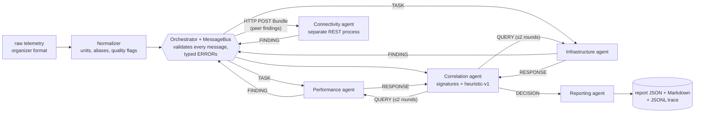

# NetCoop AI

Five specialist agents trade validatable evidence with one another over a versioned protocol (netcoop/1.0), challenge each other's findings, and then publish a single evidence-based JSON diagnosis of a campus network fault. The data involved is synthetic, so nothing ever touches a real network.

- Problem statement: [docs/problem_statement.pdf](docs/problem_statement.pdf)
- Architecture: [ARCHITECTURE.md](ARCHITECTURE.md) · context for AI coding assistants: [CLAUDE.md](CLAUDE.md)
- Phase plan and status: [docs/STATUS.md](docs/STATUS.md) · Phase 1 tasks: [docs/PHASE1_TASKS.md](docs/PHASE1_TASKS.md)
- Protocol and field reference: [PROTOCOL.md](PROTOCOL.md), generated JSON Schemas in [schemas/](schemas/)
- Organizer data and field mapping: [data/field_mapping.md](data/field_mapping.md)
- Connectivity REST service: [docs/README_track_C.md](docs/README_track_C.md)
- Demo plan: [docs/DEMO_SCRIPT.md](docs/DEMO_SCRIPT.md)

## Setup (Python 3.12)
```bash
python -m venv .venv
.venv\Scripts\activate          # macOS/Linux: source .venv/bin/activate
pip install -e ".[dev]"
pytest -q                       # 480+ tests
```

## Judge quickstart (one command)
```bash
netcoop demo        # runs all 17 labelled scenarios, prints expected vs got, writes reports/ + traces/
```
```
scenario                     expected                   got                        conf  rejected inputs
congestion                   diagnosed link_congestion  diagnosed link_congestion  0.95  -                           PASS
ambiguous_congestion_errors  probable link_congestion   probable link_congestion   0.69  -                           PASS
unsupported_2_x              insufficient_evidence      insufficient_evidence      0.00  SCHEMA_VERSION_UNSUPPORTED  PASS
...
17/17 scenarios match their label
```
Then open the dashboard on those real runs (report, one-line summary, every message of the trace incl. QUERY/RESPONSE, competing causes, interpreted evidence):
```bash
cd dashboard && npm install && npm run dev
```



## Run
```bash
# terminal 1 - the Connectivity agent as its own process
uvicorn connectivity_service.app:app --port 8001

# terminal 2 - diagnose a scenario (report -> reports/, trace with HTTP bodies -> traces/)
netcoop run scenarios/dev/congestion.json
netcoop run scenarios/dev/congestion.json --control   # Connectivity gets no peer findings: its answer changes
netcoop run scenarios/dev/congestion.json --local     # Connectivity in-process (no server needed)
netcoop run data/generator_raw/hardware_failure_unseeded.json   # untouched organizer output (1 reading: agents abstain and say why)

netcoop export-schemas                    # regenerate schemas/ + PROTOCOL.md after editing models.py
python scenarios/build_dev_fixtures.py    # rebuild the 17 labelled scenarios in scenarios/dev/
netcoop eval --n 48 --seed 6 7 8 9 10 --noise 0.10   # held-out evaluation -> eval/<run>/summary.md
```
Each run writes `reports/<incident>.json` (the report-1.0 diagnosis), `reports/<incident>.md` (the same report for humans) and `traces/<incident>.jsonl` (every message, including the QUERY/RESPONSE rounds and the HTTP bodies to and from Connectivity). Statuses: `diagnosed`, `probable`, `healthy`, `insufficient_evidence`, `invalid_input`, `failed`.

### How verification works (QUERY)
Before making a decision, Correlation **verifies** the leading hypothesis (along with a close rival) by sending a QUERY to the agent responsible for its key measurement (e.g., utilization → Performance, interface errors → Infrastructure).
- If the scenario includes **on-demand probe samples** (an `on_query` block with source `on-demand-probe`), the agent *runs the probe*: the RESPONSE then cites **new evidence IDs** that did not exist before the QUERY, and Correlation uses them to determine severity (critical versus warn only). Those samples only determine severity; the signature checks remain on the 5-minute window.
- If no probe data exists, the agent **re-reads the window's samples** and states this in the RESPONSE ("no new probe was run"); the DECISION repeats that as well. No new claims are made.
- DNS/DHCP faults are not queried: their evidence comes from Connectivity's own pass/fail service checks, which are already available.
- Confidence for `correlation_timeout` is `0.0` with method `none: correlation_failed (no heuristic-v1 score could be computed)`: no ranking could be performed, and the report states this.

### How a diagnosis is decided
Agents propose hypotheses; the **Correlation agent** checks each one again against its signature in `netcoop/config/signatures-1.0.yaml`, confirms the leader (and a close rival) with a **QUERY** to the agent that owns the key measurement, and scores it using **`heuristic-v1`** (every factor is documented in `netcoop/agents/correlation.py`). Gates: `diagnosed` requires confidence ≥ 0.70, coverage ≥ 0.75, two independent raw sources, a 0.15 lead **and no unresolved rival** (a hypothesis the agents raised that the evidence can neither confirm nor refute is listed in `alternative_causes` and blocks a diagnosis); `probable` states what is missing; `healthy` requires normal measurements **and** passing service and path checks; otherwise the system abstains with `insufficient_evidence`. Confidence values are documented heuristics, not calibrated probabilities, so the report caps them by status: `diagnosed`/`healthy` at most 0.95 (nothing from one window is certain) and `probable` at most 0.69 (it never scores higher than a cause that passed the 0.70 gate). The uncapped score remains in the DECISION, and the cap is named in `limitations`.

### What every report tells you
- `summary`: one plain sentence, e.g. *Probably link congestion on DEPT_UPLINK_01, affecting SW_CAMPUS_2, but not confirmed: interface_fault@DEPT_UPLINK_01 cannot yet be ruled out. Verify before acting.*
- `supporting_evidence[]`: evidence ID, metric, value, unit, raw source, per-interval delta for counters, and `interpretation` against the configured threshold (*above critical 90 percent*).
- `validation_errors`: every input message the bus rejected, with its typed code and field (`SCHEMA_VERSION_UNSUPPORTED`, `MISSING_FIELD`, `DUPLICATE_MESSAGE`, ...).
- `limitations`: the time window, the confidence cap, any malformed/missing/stale readings that were excluded, and the before/after ranking of each QUERY round.

### Held-out evaluation (Phase 4)
`netcoop eval` generates incidents from `netcoop/evaluation/heldout.py` (committed before any result was looked at; new seeds, times, topology positions and metric mixes; labels come from the fault the generator overlays, never from the system), runs each one, and publishes every ARCHITECTURE §7 metric. Results, with the pre-registered first run, the bug it found and every non-exact case's trace: [`docs/results/PHASE4_RESULTS.md`](docs/results/PHASE4_RESULTS.md).

| fresh seeds 6–10, 240 cases | σ 0 | σ 0.05 | σ 0.10 | σ 0.15 |
|---|---|---|---|---|
| exact (status + cause) | 100 % | 100 % | 99.2 % | 96.7 % |
| false diagnosis on healthy / busy-but-healthy / stale (90 cases) | 0 | 0 | 0 | 0 |
| wrong diagnoses / hedged wrong | 0 / 0 | 0 / 0 | 0 / 0 | 0 / 0 |
| abstained (fault classes) | 0 | 0 | 2 | 6 |

These numbers come from our own fault model: they show the logic holds across positions, timing and noise, not how it would score on real campus telemetry.

## How it works
| Component | Role |
|---|---|
| Normalizer | Converts raw telemetry to canonical observations; keeps original field/value; flags missing, stale, converted data (never turns missing into 0) |
| Orchestrator + bus | Validates **every** message, drops duplicates, turns every failure into a typed `ERROR`, logs all traffic to SQLite |
| Performance agent | Latency, jitter, loss, throughput, utilization |
| Infrastructure agent | CPU/memory, queue drops, interface errors, flaps, Wi-Fi signal/retries; emits supporting **and contradicting** findings |
| Connectivity agent | Separate REST process; topology, blast radius, DNS/DHCP, reachability; reads peer findings before answering |
| Correlation agent | Ranks causes, sends QUERY when evidence conflicts, abstains when evidence is thin (`heuristic-v1` confidence) |
| Reporting agent | Produces the final JSON report using only cited evidence |

Statuses: `diagnosed`, `probable`, `healthy`, `insufficient_evidence`, `invalid_input`, `failed`. Only the first two may name a cause.

## Repository layout
| Path | Contents |
|---|---|
| `netcoop/protocol/` | Protocol models (source of truth), schema export, version compatibility, agent cards |
| `netcoop/normalizer/` | Organizer-generator adapter |
| `netcoop/orchestrator/` | Message bus and SQLite event log |
| `netcoop/config/signatures-1.0.yaml` | Versioned thresholds, fault signatures, check vocabulary, decision gates |
| `connectivity_service/` | Connectivity agent REST service |
| `scenarios/` | Topology, labeled dev scenarios (`labels.json` is never read at runtime) |
| `examples/` | One valid message per type, old/new-version samples, report samples |

## Team workflow
- One branch per task (`m1/<name>-<topic>`), PR + one review, `pytest -q` green on `main`.
- Only the protocol lead edits `netcoop/protocol/models.py`; run `netcoop export-schemas` and commit the regenerated files in the same PR.

## Limitations
- Each time the organizer generator is called, it returns a single reading for a single device, and it does not provide any topology information, repeated samples, or fault labels. We rely on it to demonstrate that we can ingest the official format exactly as it is, without any modifications; meanwhile, diagnostic accuracy is evaluated using our own labeled scenarios, which are stored in the `scenarios/` directory.
- Thresholds are documented heuristics rather than probabilities that have been calibrated in any formal way.
- For held-out evaluation, we rely on our own generator (see above and `docs/results/PHASE4_RESULTS.md`); there are no held-out incidents that involve two faults.